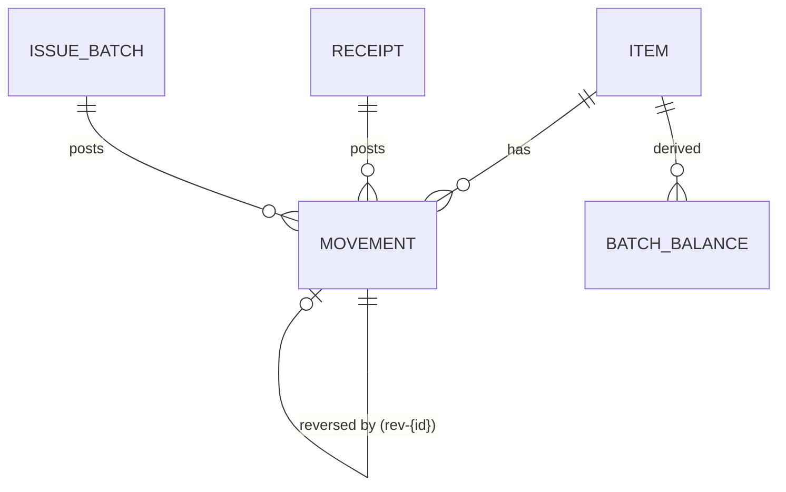

# Data Model: Daily Operations (Phase 1)

**Feature**: [spec.md](./spec.md) · **Research**: [research.md](./research.md)

Storage is Cloud Firestore. All collections sit at the database root. There is one owner (R3).

**Conventions**:
- Dates written by the user (business dates) are strings `YYYY-MM-DD`.
- System times are server timestamps.
- Money is a number of Egyptian pounds with up to 2 decimals, stored as an integer number of
  **piastres** (`priceMinor`) to avoid floating-point drift.
- Quantities are integers.

## Entity overview

## `items/{code}`

The document ID is the item code (e.g. `SCR-01`).

| Field | Type | Rules |
|---|---|---|
| `code` | string | equals the doc ID; pattern `^[A-Z]{3}-\d{2,3}$` (same pattern as the search classifier, research R5) |
| `page` | int | unique, ≥ 1 (رقم الصفحة; workbook column م) |
| `category` | string | one of the 7 workbook categories, or a new one the user adds |
| `nameAr` / `nameEn` | string | required / optional |
| `material`, `size`, `unit` | string | `unit` defaults to `قطعة` |
| `supplier` | string | optional |
| `gtins` | string[] | each `^\d{8}$` or `^\d{13}$` (EAN-8 / EAN-13); globally unique, checked on the client before linking (FR-033) |
| `priceMinor` | int | latest purchase price; updated when a receipt is posted (FR-034) |
| `reorderManual` | int \| null | the manual reorder point (workbook column R) |
| `active` | bool | default true |
| `updatedAt` | timestamp | server time |

Item edits are allowed (FR-014). They never touch movements, because prices live on each
movement.

## `movements/{id}` (create-only)

ID schemes:
- `imp-r{row}`: imported rows.
- `{docId}-L{n}`: posted document lines.
- `rev-{originalId}`: reversals.
- UUID: manual returns and adjustments.

| Field | Type | Rules |
|---|---|---|
| `type` | `"إضافة" \| "صرف" \| "مرتجع" \| "تسوية"` | |
| `itemCode` | string | must exist when the movement is created (checked on the client; rules cannot afford a per-movement lookup, research R2) |
| `qty` | int | > 0 for إضافة/صرف/مرتجع; ≠ 0 (signed) for تسوية |
| `businessDate` | string | `YYYY-MM-DD`, not in the future |
| `postedAt` | timestamp | `request.time` (enforced by rules) |
| `priceMinor` | int | the unit price snapshot at posting (constitution II) |
| `batchNo` / `expiry` | string \| null | `expiry` is `YYYY-MM` or `YYYY-MM-DD` |
| `docNumber` | string \| null | رقم الفاتورة / الإذن (workbook column L) |
| `reference` | string \| null | المرجع (workbook column P), e.g. `طلبية`, `منصرف شهري`, `دفعة 14` |
| `note` | string \| null | ملاحظات |
| `supplier` | string \| null | |
| `source` | `{kind: "import"\|"receipt"\|"issue"\|"manual", id: string\|null, row?: int}` | |
| `substituteFor` | `{itemCode, qty} \| null` | set on an issue line that replaced a requested item (FR-043) |
| `reverses` | string \| null | the original movement ID (only on `rev-*`) |
| `reason` | string \| null | required for reversals, returns, adjustments and negative issues |
| `deviceId` | string | a random per-install ID, for diagnostics |
| `createdBy` | string | the owner's UID |

**Derived values** (never stored):
- **Effect** on balance: إضافة `+qty`, صرف `−qty`, مرتجع `+qty`, تسوية `+qty` (signed). This is
  the workbook's `H − I + J + K`.
- **Reversal**: a reversal is a تسوية whose qty equals the negated effect of the original, with
  the same item, batch and price, and `reverses` set. A movement is "reversed" when
  `rev-{id}` exists.

## `receipts/{id}` (UUID)

| Field | Type | Notes |
|---|---|---|
| `status` | `draft \| posted \| cancelled` | transitions in [contracts/firestore-rules.md](./contracts/firestore-rules.md) |
| `supplier`, `deliveryNo`, `invoiceNo`, `businessDate` | string | `deliveryNo` is the delivery-note number from the supplier |
| `lines[]` | `{n, itemCode \| null, scannedGtin \| null, batchNo, expiry, invoicedQty, countedQty, priceMinor, prevPriceMinor, diffReason}` | `itemCode` is null while a GTIN is unresolved |
| `postedAt`, `cancelledAt`, `cancelReason` | | set at the transitions |
| `priceUpdates[]` | `{itemCode, fromMinor, toMinor}` | written at posting; used on cancel |

**Post rule** (client, one atomic batched write):
1. Every line resolves to an item.
2. Lines where `countedQty ≠ invoicedQty` need a `diffReason`.
3. Then write movement `{id}-L{n}` (type إضافة, `qty = countedQty`).
4. Then update item `priceMinor` and append the GTIN.
5. Then set `status = posted`.

**Cancel rule** (receipt):
1. Write a reversal for each line (`rev-{lineMovementId}`, a تسوية with the negated qty).
2. For each `priceUpdates` entry, if the item's current price still equals `toMinor` (no later
   receipt changed it), restore `fromMinor`. Otherwise keep the current price.
3. GTIN links made by the receipt **stay**, because the barcode-to-item fact is still true.
4. Set `status = cancelled`. This is one atomic batch.

## `issueBatches/{id}` (UUID)

| Field | Type | Notes |
|---|---|---|
| `number` | int | local sequential number (R10); duplicates after sync show a warning |
| `status` | `draft \| posted \| cancelled` | |
| `rep`, `businessDate` | string | rep = name of the مندوب |
| `permits` | string[] | patient permit **numbers only** (no names) |
| `requested[]` | `{itemCode, qty}` | aggregated by item (FR-041) |
| `issued[]` | `{n, itemCode, qty, batchNo, expiry, forItemCode \| null, negativeReason \| null}` | `forItemCode` set when this line substitutes a requested item |
| totals | derived | requested value, issued value and difference come from item prices at posting (FR-045) |

**Post rule**:
1. Every requested quantity is covered by issued lines for the same item or substitutes
   (`forItemCode`), or reduced.
2. Issued quantity beyond the current balance needs `negativeReason`.
3. Then write movement `{id}-L{n}` (type صرف, `substituteFor` from `forItemCode`,
   `reference = "دفعة {number}"`).
4. Then set `status = posted`.

## `settings/app`

| Field | Default |
|---|---|
| `coverageMonths` | 1.5 |
| `defaultReorder` | 5 |
| `lastBackupAt` | null |
| `lastLedgerExportAt` / `lastLedgerExportedIds` | null / [] |
| `workbookImport` | `{importedAt, movementCount, fileName} \| null` (FR-004 guard) |

## Derived state (client only)

| Name | Definition |
|---|---|
| `balance(item)` | Σ effect of the item's movements |
| `batchBalance(item, batchNo, expiry)` | same, grouped by batch; `null` batch → "تشغيلة غير محددة" |
| `monthsOfConsumption` | `max(1, round((maxDate − minDate) / 30 days))` over all movements |
| `reorderPoint(item)` | `reorderManual` if > 0; else if `issued > 0` then `max(1, ceil(issued / monthsOfConsumption × coverageMonths))`; else `defaultReorder` |
| `status(item)` | `<0` "تجاوز — رصيد سالب"; `=0` "نافد"; `≤ reorderPoint` "يحتاج طلب"; else "متاح" |
| `pendingSettlement(item)` | `balance < 0` |
| `changedSinceSeen(item)` | latest `postedAt` of the item's movements > the device-local `seenAt[item]` |
| `substitutes(item, shortQty)` | active items with the same `category`, `balance > 0`, not the item itself, sorted by `abs(price − item.price)`, then by balance descending |

`issued` uses the total of صرف movements, matching workbook column I, so reversals do not change
it. A reversal is a تسوية and adjusts the balance only. This matches the workbook, where a صرف
row's quantity stays in I.

## Validation summary

The client validates with zod schemas shared with the import and rules tests. The server
validates with rules ([contracts/firestore-rules.md](./contracts/firestore-rules.md)). The rules
are the backstop: when the two disagree, the rules win.
